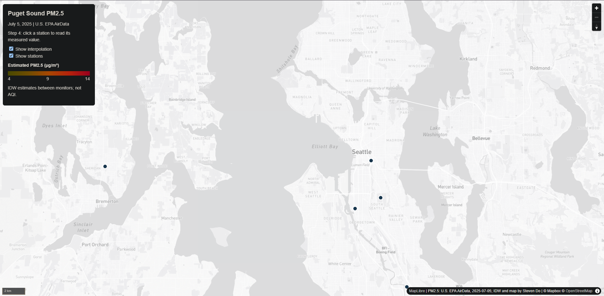
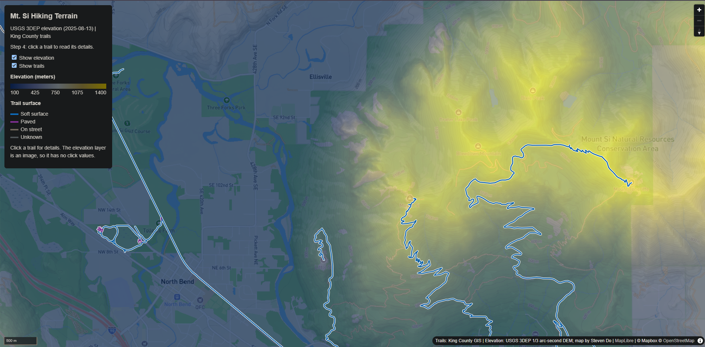

# Lab 3

For this lab I made two web maps. The first one shows PM2.5 air pollution around Puget Sound, and the second one shows terrain and trails around Mt. Si. Both use a basemap I designed in Mapbox Studio, a raster layer I exported from QGIS as PNG tiles, and a vector layer on top that you can click.

## Map 1: Puget Sound PM2.5

This map is for anyone who wants to see where fine particle pollution was higher or lower around Puget Sound on one day, and how that lines up with the freeways. The study area runs from about -122.75 to -122.05 longitude and 47.10 to 48.15 latitude, which covers Tacoma to Marysville, including Seattle and Bremerton.

The PM2.5 data comes from EPA AirData and has 11 monitoring stations on July 5, 2025. In Mapbox Studio I started from Mapbox Light, removed five commercial POI classes, and made the freeways a darker gray than the other roads. I exported the basemap from QGIS with QMetaTiles at zoom 8 to 12. Then I ran IDW interpolation on the stations styled it from 4 to 14, and exported it as a second set of tiles with a transparent background.

## Map 2: Mt. Si hiking terrain

This map is for day hikers around North Bend who want to see how steep the land is and what the trails are like. The study area is about -121.82 to -121.68 longitude and 47.45 to 47.57 latitude, and the tiles go from zoom 10 to 15.

The elevation layer is the USGS 3DEP 1/3 arc-second DEM, which I clipped to the study area and colored from 100 to 1400 m. The trails are from King County's "Trails in King County" layer. I clipped them to the study area, which left 101 segments, and colored them by surface type. Clicking a trail shows its name, surface, type and manager. For the basemap I used a style based on Mapbox Outdoors, and made the trails easier to see. The basemap and the elevation were exported as separate tile sets at zoom 10 to 15.

The elevation and trails go together because the colors show how high the ground is and the lines show where you can walk on it. One limit is that the elevation layer is only a picture, so you can't click it to get a number. The county also says city and private trails may be missing, so the trail layer isn't complete.

## Screenshots

## Sources

EPA AirData, USGS 3DEP, King County GIS, © Mapbox © OpenStreetMap contributors.